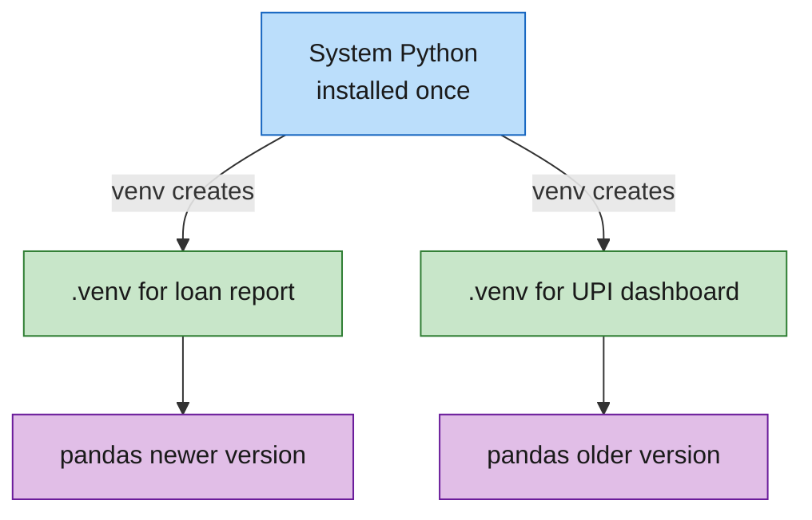
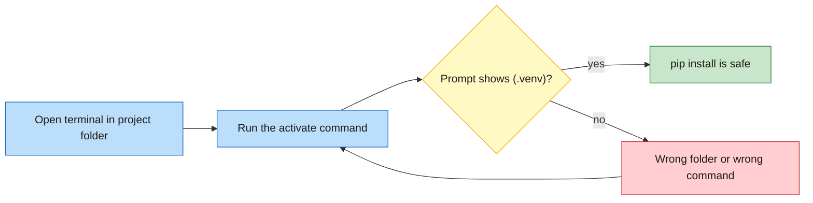


**Trainer notes**

Sample page written for candidates in India, on a mix of Windows laptops and Macs. It shows the structure and depth every page should have.

Time: 45 minutes (10 talk, 5 diagram, 30 lab).
Open with: "Who has installed something and then broken something else?" Wait for hands, then take one story.
Land this: each project gets its own packages, and the prompt tells you which project you are in.


## What you will learn

- Why installing every package into one shared Python causes trouble
- What a virtual environment contains and how activation changes your terminal
- How to create, use and delete one on Windows, macOS and Linux
- How to record the packages a project needs in `requirements.txt`

## Explanation

Python lives on your machine once. Every `pip install` you run without a virtual environment goes into that single shared place. That works until two projects need different versions of the same package. Upgrade it for one project and the other one stops working, usually on the day of a demo.

A virtual environment is a folder inside your project. It holds a private copy of the packages that project needs, plus a small `pyvenv.cfg` file that records which Python created it. Python itself is not duplicated in full. The environment points back to the installed Python and keeps its own empty `site-packages` folder, which is where `pip` puts new packages.

The diagram shows one Python serving two projects. Each project has its own environment, and each environment holds its own version of pandas.



Creating the folder is only half the job. You also have to activate it. Activation puts the environment's `Scripts` folder (Windows) or `bin` folder (macOS and Linux) at the front of your search path. After that, typing `python` or `pip` runs the copies inside the environment. The terminal prompt gains a `(.venv)` prefix so you can see it worked.

Follow the green path first, then the red one.




**Ask the room:** "If I delete the `.venv` folder, do I lose my project?" Expected answer: no. The environment holds only installed packages. Your code and `requirements.txt` stay, and you can rebuild the environment in a minute.


## Real-life example

Picture a flat in Navi Mumbai shared by five people and one fridge. Nothing is labelled. On Tuesday one flatmate replaces the full-cream milk with oat milk because it is healthier. On Wednesday four people make chai, and all four have questions.

A shared global Python is that fridge. One person upgrades one thing, and everyone downstream finds out at breakfast. A virtual environment gives each project its own mini-fridge. The kitchen is the same and the shelves are separate, so an oat milk experiment stays in one fridge.

| In the story | In the system |
|---|---|
| The shared fridge in the flat | The global Python install |
| A flatmate swaps the milk | One project upgrades a package |
| Four chai cups go wrong | Four other projects break |
| A personal mini-fridge | A virtual environment |
| The kitchen they all share | The one installed Python |

## Official docs

The Python documentation for the `venv` module covers creation options, activation commands for every shell and the layout of the environment folder: [venv, Creation of virtual environments](https://docs.python.org/3/library/venv.html).

## Code

The lab uses a small dataset, `spend.csv`, with eight personal transactions for one month, in rupees. The columns are `date`, `merchant`, `category` and `amount_inr`. It is small enough to total by hand, so candidates can check the program's answer: the full total is 5500.

The report groups the rows by category and adds up the amounts. This is the line that does the work:

```python
summary = spend.groupby("category")["amount_inr"].sum().sort_values(ascending=False)
```

Read it from left to right. `groupby("category")` collects the rows that share a category. `["amount_inr"].sum()` adds the amounts inside each group. `sort_values(ascending=False)` puts the biggest category first. The program needs pandas, and pandas is installed into the virtual environment, so the lab proves the environment works by running a program that cannot run without it.

## Lab

### Goal

Build a virtual environment, install pandas into it, run a spending report, then leave the environment and see what changes.

### Time

30 minutes.

### Prerequisites

| Need | How to check | Expected |
|---|---|---|
| Python 3.10 or higher | Windows: `python --version`. macOS and Linux: `python3 --version` | A line such as `Python 3.12.4`. Any version from 3.10 up is fine. |
| Internet access | Open any website in a browser | The page loads. `pip` needs it in Step 7. |
| A plain text editor | Notepad (Windows), TextEdit (macOS), or any editor you already use | You can create and save a file. |

### Environment

Any of Windows 10 or 11, macOS or Linux. Commands that differ are shown for each system. The work happens in a new folder called `spend-report`.

### Steps

#### Step 1: Open a terminal

**Why:** Every command in this lab is typed into a terminal.

**Where:** Your desktop.

**Action:**

- Windows: press the Windows key, type `cmd`, press Enter. A black window titled Command Prompt opens.
- macOS: press Command and Space, type `Terminal`, press Enter.
- Linux: press Ctrl, Alt and T, or open Terminal from your application menu.

**Expected result:** A window with a blinking cursor after a prompt.

#### Step 2: Check that Python is installed

**Why:** The next steps fail with a confusing message if Python is missing, so check first.

**Where:** The terminal from Step 1.

**Action:**

Windows:

```bash
python --version
```

macOS and Linux:

```bash
python3 --version
```

**Expected result:** A line such as `Python 3.12.4`. Your number may differ. It must be 3.10 or higher.

**If it differs:** See the first two rows of the troubleshooting table.

#### Step 3: Create the project folder

**Why:** The environment, the data and the script all live together in one folder.

**Where:** The terminal. It starts in your home folder, which is fine.

**Action:**

```bash
mkdir spend-report
```

```bash
cd spend-report
```

**Expected result:** The first command prints nothing. After the second, the prompt shows `spend-report` at the end of the path.

#### Step 4: Create the virtual environment

**Why:** This builds the private set of packages for the project.

**Where:** The terminal, inside `spend-report`.

**Action:**

Windows:

```bash
python -m venv .venv
```

macOS and Linux:

```bash
python3 -m venv .venv
```

**Expected result:** The command prints nothing and returns to the prompt. A new folder named `.venv` now exists. Check it.

Windows:

```bash
dir /a
```

macOS and Linux:

```bash
ls -a
```

You should see `.venv` in the list.

#### Step 5: Activate the environment

**Why:** Activation makes `python` and `pip` use the copies inside `.venv`.

**Where:** The terminal, inside `spend-report`.

**Action:**

Windows (Command Prompt):

```bash
.venv\Scripts\activate.bat
```

macOS and Linux:

```bash
source .venv/bin/activate
```

**Expected result:** The prompt now starts with `(.venv)`.


**Checkpoint:** Every candidate sees `(.venv)` at the start of the prompt. Do not move on until they do.


**If it differs:** If Windows says the path cannot be found, run `dir /a` and confirm `.venv` is listed. If it is not, you are in the wrong folder, so go back to Step 3.

#### Step 6: Confirm which Python you are using

**Why:** The prompt prefix is a hint. This command shows the proof.

**Where:** The terminal, with `(.venv)` showing.

**Action:**

```bash
python -c "import sys; print(sys.prefix)"
```

**Expected result:** A path that ends in `spend-report` followed by `.venv`. For example, on macOS or Linux it ends in `/spend-report/.venv`, and on Windows it ends in `\spend-report\.venv`.

#### Step 7: Install pandas

**Why:** pandas will exist only inside this environment.

**Where:** The terminal, with `(.venv)` showing.

**Action:**

```bash
pip install pandas
```

**Expected result:** Several lines of download progress, ending with a line that starts with `Successfully installed`. It lists pandas and the packages it needs, such as numpy. Version numbers will differ from the ones in this page.


**Watch the room:** If the prompt has no `(.venv)` prefix, stop. `pip install` would put pandas into the shared Python, which is the problem this lesson exists to prevent. Go back to Step 5.


#### Step 8: Create the data file

**Why:** The report needs something to read.

**Where:** Your text editor, saving into the `spend-report` folder.

**Action:** Create a new file named `spend.csv` in the `spend-report` folder with exactly this content:


```csv
date,merchant,category,amount_inr
2026-10-01,Irani Cafe Marine Lines,Food,180
2026-10-02,Mumbai Local Monthly Pass,Transport,520
2026-10-04,Reliance Fresh,Groceries,1340
2026-10-07,Auto Rickshaw Kharghar,Transport,95
2026-10-11,Vada Pav Corner,Food,60
2026-10-15,Electricity Bill,Utilities,1875
2026-10-18,Reliance Fresh,Groceries,980
2026-10-22,Dinner at Udupi Restaurant,Food,450
```


**Expected result:** A file called `spend.csv` sits next to the `.venv` folder.

**If it differs:** Windows Notepad often saves `spend.csv.txt`. In the Save dialog, set "Save as type" to "All files" and type the name `spend.csv`. On macOS, open TextEdit, choose Format, then Make Plain Text, before saving.

#### Step 9: Create the report script

**Why:** This program reads the data and prints the totals.

**Where:** Your text editor, saving into the `spend-report` folder.

**Action:** Create a file named `report.py` with exactly this content:


```python
import pandas as pd

spend = pd.read_csv("spend.csv")
summary = spend.groupby("category")["amount_inr"].sum().sort_values(ascending=False)

print("Spend by category (INR)")
print(summary.to_string())
print()
print("Total:", spend["amount_inr"].sum())
```


**Expected result:** A file called `report.py` sits next to `spend.csv`.

#### Step 10: Run the report

**Why:** This proves the environment has pandas and the program works.

**Where:** The terminal, with `(.venv)` showing, inside `spend-report`.

**Action:**

```bash
python report.py
```

**Expected result:**

```text
Spend by category (INR)
category
Groceries    2320
Utilities    1875
Food          690
Transport     615

Total: 5500
```


**Checkpoint:** The total is 5500. Ask one candidate to add up the Food rows by hand (180, 60 and 450 make 690) and compare.


#### Step 11: Record the packages

**Why:** `requirements.txt` lets anyone rebuild this exact environment.

**Where:** The terminal, with `(.venv)` showing.

**Action:**

```bash
pip freeze > requirements.txt
```

Then print the file. Windows:

```bash
type requirements.txt
```

macOS and Linux:

```bash
cat requirements.txt
```

**Expected result:** A list with one package per line in the form `name==version`, including `pandas` and `numpy`. Versions will differ from yours.

#### Step 12: Leave the environment

**Why:** Deactivation returns the terminal to the shared Python.

**Where:** The terminal.

**Action:**

```bash
deactivate
```

**Expected result:** The `(.venv)` prefix disappears from the prompt.

#### Step 13: Run the report outside the environment

**Why:** This shows what the environment was protecting.

**Where:** The terminal, inside `spend-report`, with no `(.venv)` prefix.

**Action:**

Windows:

```bash
python report.py
```

macOS and Linux:

```bash
python3 report.py
```

**Expected result:** One of two outcomes, and both teach something.

- On a machine with no global pandas, you see `ModuleNotFoundError: No module named 'pandas'`. The package lives only inside the environment.
- On a machine that already has pandas installed globally, the report runs and prints the same table. That means an earlier global install is sitting in the shared Python, which is the fridge from the example.


**Expected error:** `ModuleNotFoundError` in this step is the intended result, not a mistake. Tell candidates before they run it.


### Verify

You finished the lab correctly if all three are true:

- Step 10 printed a total of 5500.
- `requirements.txt` exists and lists pandas.
- After Step 12 the `(.venv)` prefix was gone.

### Cleanup


**Check before deleting.** The deletion commands below are permanent. Confirm the folder name is `spend-report` before you press Enter.


Move out of the project folder, then delete it.

Windows:

```bash
cd ..
rmdir /s /q spend-report
```

macOS and Linux:

```bash
cd ..
rm -rf spend-report
```

### Troubleshooting

| Symptom | Likely cause | Fix |
|---|---|---|
| `'python' is not recognized` on Windows | Python is not installed, or was installed without being added to the path | Reinstall from python.org and tick the option to add Python to the path |
| `command not found: python` on macOS or Linux | Only `python3` exists outside an environment | Use `python3` until you activate, then `python` works |
| Activate says the path cannot be found | You are in the wrong folder | Run `dir /a` or `ls -a`, confirm `.venv` is listed, or `cd` into `spend-report` |
| Prompt has no `(.venv)` after activating | The activate command did not run in this window | Run the Step 5 command again in the same window |
| `ModuleNotFoundError` inside the environment | pandas was installed outside it | Activate, then run `pip install pandas` again |
| `spend.csv.txt` instead of `spend.csv` | The editor added its own extension | Save again as "All files" with the exact name, or rename the file |

### Stretch

Delete the `.venv` folder, create a new one, and rebuild it with `pip install -r requirements.txt`. Run the report again and confirm the total is still 5500.

## Check your understanding

<details>

<summary>1. Why does `pip install` without an active environment cause trouble?</summary>

It installs into the shared Python, so a version change for one project affects every other project on the machine.

</details>

<details>

<summary>2. What two things change when you activate an environment?</summary>

The search path now starts with the environment's `Scripts` or `bin` folder, so `python` and `pip` run the environment's copies. The prompt gains a `(.venv)` prefix.

</details>

<details>

<summary>3. You delete the `.venv` folder. What do you still have, and how do you get the packages back?</summary>

Your code, your data and `requirements.txt` are untouched. Create a new environment, activate it, and run `pip install -r requirements.txt`.

</details>
