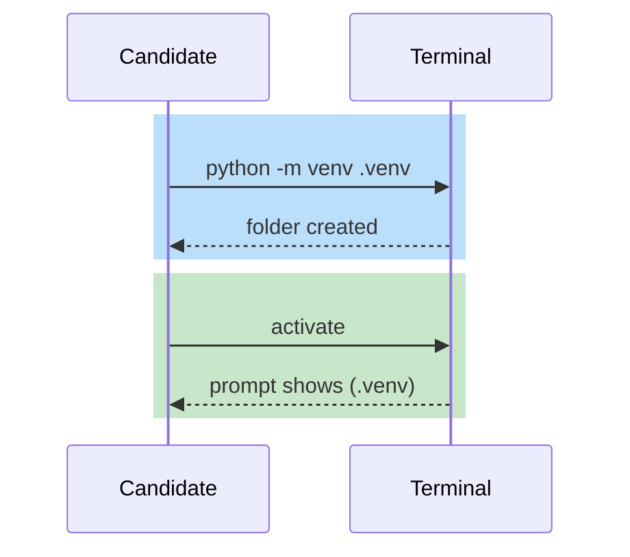
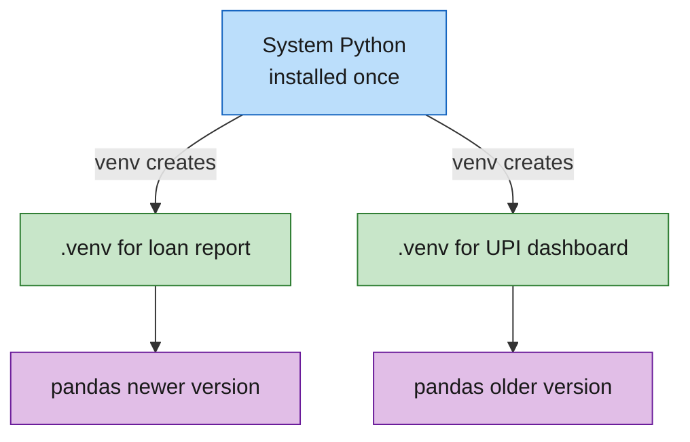

# Diagrams and colors

Contents: the palette, a paste-ready style block, diagram types, sizing rules, an example.

## Why Mermaid

A diagram reaches candidates faster than a paragraph, and Mermaid keeps it as text, so it lives in the markdown file, diffs cleanly and needs no image files. Use a fenced block with the language set to `mermaid`.

## The five colors

Use only green, blue, yellow, purple and red. Each color has one job, so candidates read the diagram without a legend.

| Color | Job | Fill | Stroke |
|---|---|---|---|
| Green | Start, success, healthy state, final result | `#c8e6c9` | `#2e7d32` |
| Blue | Normal process step, component, service | `#bbdefb` | `#1565c0` |
| Yellow | Decision, wait, caution | `#fff9c4` | `#f9a825` |
| Purple | Data, storage, external system | `#e1bee7` | `#6a1b9a` |
| Red | Error, risk, failure path | `#ffcdd2` | `#c62828` |

Text color is `#1a1a1a` on every node. No other colors. No default grey nodes, so every node gets a class.

## Paste-ready style block

Put this at the bottom of each flowchart and assign a class to every node with `:::name`.

```text
classDef green fill:#c8e6c9,stroke:#2e7d32,color:#1a1a1a
classDef blue fill:#bbdefb,stroke:#1565c0,color:#1a1a1a
classDef yellow fill:#fff9c4,stroke:#f9a825,color:#1a1a1a
classDef purple fill:#e1bee7,stroke:#6a1b9a,color:#1a1a1a
classDef red fill:#ffcdd2,stroke:#c62828,color:#1a1a1a
```

Only declare the classes the diagram uses.

## Sequence diagrams

Sequence diagrams do not support `classDef`. Color them with `rect` blocks using these RGB values:

- Green: `rgb(200, 230, 201)`
- Blue: `rgb(187, 222, 251)`
- Yellow: `rgb(255, 249, 196)`
- Purple: `rgb(225, 190, 231)`
- Red: `rgb(255, 205, 210)`



## Choosing the diagram type

| Showing | Use |
|---|---|
| Steps, flows, decisions, architecture | `flowchart` (use `LR` for short flows, `TB` for layered ones) |
| Who talks to whom, in order | `sequenceDiagram` |
| Tables and relationships | `erDiagram` |
| States and transitions | `stateDiagram-v2` |
| Order of events over time | `timeline` |

## Sizing rules

- One idea per diagram. Split a diagram that needs more than 12 nodes.
- Node text is 5 words or fewer. Put detail in the paragraph above.
- Label every arrow that is not obvious.
- Put the diagram right after the paragraph it explains, and add one sentence saying how to read it, such as "Follow the green path first, then the red one."
- Every page should have at least one diagram, and architecture pages should have two.

## Example



## If the diagram does not render

GitBook needs to render `mermaid` fenced blocks in the user's space. If a diagram shows as plain code, the space may need the Mermaid integration. Tell the user once, and do not change the diagrams to images.
